# PSC与ARR怎么算：STM32F103C8T6 定时器定时的参数推导与PWM呼吸灯实现

> 平台：STM32F103C8T6 最小系统核心板（Blue Pill）  
> 环境：STM32CubeMX（STM32Cube FW_F1 V1.8.7）+ Keil MDK-ARM V5.32 + ST-Link V2  
> 内容：任务一用 TIM2 的**更新中断**控制 LED 以 2 s 周期亮灭；任务二把 TIM2 通道 1 配成 **PWM 输出**做呼吸灯，并用 Keil 软件仿真的逻辑分析仪定量分析  

---

## 一、实验目的

1. 掌握定时器的时基结构（PSC、CNT、ARR 与更新事件）和定时时间的计算方法。
2. 掌握用**更新中断**实现精确定时，理解它相对软件延时的优势。
3. 掌握 **PWM 输出模式**的配置与占空比计算。
4. 会用动态修改 CCR 实现呼吸灯，并能用 Keil 仿真中的逻辑分析仪观察、测量波形。

## 二、实验器材与引脚分配

**器材**：STM32F103C8T6 最小系统板、面包板、红色 LED、220 Ω 限流电阻、杜邦线、ST-Link V2；软件为 STM32CubeMX 与 Keil MDK-ARM V5.32。

**引脚（两个任务共用）**：PA0 → **TIM2_CH1**，外接红色 LED，**高电平点亮**。这样任务一的 GPIO 翻转与任务二的 PWM 输出可以复用同一套接线，只改软件配置。

**时钟**：HSE 8 MHz 经 PLL ×9 得到 SYSCLK = 72 MHz，HCLK = 72 MHz，APB1 = 36 MHz，APB2 = 72 MHz。

## 三、实验原理

### 3.1 时基：PSC、CNT、ARR

定时器本质是"数数"的硬件：时钟每来一个脉冲 CNT 加 1，数到 ARR 后归零，同时产生一次**更新事件**。预分频器 PSC 决定脉冲的疏密：

```
计数频率  f_CNT = f_TIM / (PSC + 1)
溢出时间  T_UPDATE = (PSC + 1) × (ARR + 1) / f_TIM
```

两点必须注意：① CubeMX 里填的是"减一后的值"，`7200-1` 表示 **7200 分频**；② TIM2 挂在 APB1 上，**APB 分频不为 1 时定时器时钟等于 APB 时钟的 2 倍**，本例是 72 MHz 而不是 36 MHz。

更新事件可以产生中断（任务一用它翻转 LED），也可以只在硬件内部发生（任务二只关心波形，不开中断）。

### 3.2 更新中断方式

把定时器配成 1 s 溢出一次，在中断回调里翻转 PA0，就得到"亮 1 s、灭 1 s"，**亮灭周期 2 s**。主循环完全空转，定时精度只由硬件时钟保证，不受主循环其他代码耗时影响。

### 3.3 PWM 输出方式

计数器 CNT 与比较寄存器 CCR 持续比较：**CNT < CCR 输出高电平，CNT ≥ CCR 输出低电平**。因此

```
占空比     d = CCR / (ARR + 1)
高电平时间 T_ON = d × T_PWM
LED 平均电压 = 3.3 V × d
```

要注意区分两个量级：**PWM 周期是毫秒级（1 ms），呼吸周期是秒级（2 s）**。波形由硬件自动产生，CPU 只是每隔一段时间改一个数（改 CCR）。这正是任务二与任务一的本质区别——任务一让 CPU 参与（中断翻引脚），任务二让 CPU 退出。

### 3.4 两个任务的参数设计

| 参数 | 任务一（计数方式） | 任务二（PWM 方式） |
| --- | --- | --- |
| Prescaler (PSC+1) | 7200 → 计数 10 kHz | 72 → 计数 **1 MHz** |
| Counter Period (ARR+1) | 10000 → 更新 **1 s** | 1000 → PWM **1 ms（1 kHz）** |
| 通道 | 不用通道，只用更新中断 | Channel1 = PWM Generation CH1 |
| 中断 | 使能 TIM2 global interrupt | 不使能（轮询改 CCR） |
| 现象 | 亮 1 s / 灭 1 s，周期 2 s | 占空比 0→100%→0，呼吸周期 2 s |

任务二的呼吸节奏：CCR1 每 1 ms 加 1（或减 1），0→1000 需 1 s（渐亮），1000→0 又 1 s（渐灭），**全周期 2 s**，落在题目要求的 1~2 s 内。

## 四、任务一：定时器计数方式控制 LED 以 2 s 周期亮灭

### 4.1 CubeMX 配置

1. **RCC**：HSE 选 Crystal/Ceramic Resonator（图 1）；**SYS**：Debug 选 Serial Wire（图 2）。
2. **Clock Configuration**：HSE 8 MHz → PLL ×9 → SYSCLK 72 MHz，APB1 /2 = 36 MHz（图 3）。
3. **Project Manager**：工程名 `task1`、Toolchain = MDK-ARM V5.32（图 4）；**Code Generator** 勾选"只复制必要库文件"与"按外设生成 .c/.h"（图 5）。
4. **TIM2**：Clock Source = Internal Clock，Channel1~4 全保持 Disable；`Prescaler = 7200-1`、`Counter Period = 10000-1`、auto-reload preload = Enable（图 6），即计数 10 kHz、溢出 1 s；`NVIC Settings` 勾选 **TIM2 global interrupt**（图 7）。
5. **PA0** → GPIO_Output，模式 **Output Push Pull**、初始电平 Low、无上下拉、速度 Medium（图 8、图 9）。
6. 保存后 **GENERATE CODE** → Open Project，Keil 打开 `MDK-ARM\task1.uvprojx`。

先把时钟源从内部 RC 换成板上 8 MHz 外部晶振——这是后面 PLL ×9 能出 72 MHz 的前提。

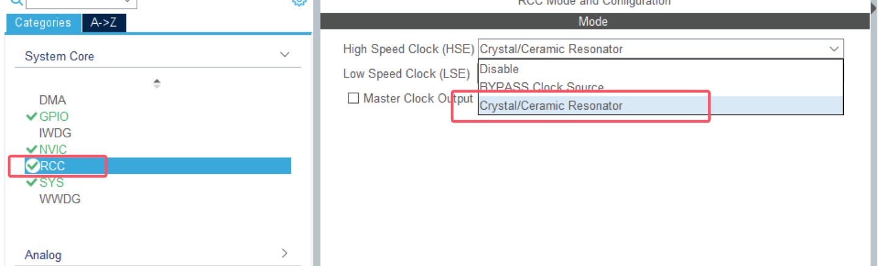

*图 1　RCC 中把 HSE 设为 Crystal/Ceramic Resonator*

调试接口选 SWD 两线，只占 PA13/PA14，不会像 JTAG 那样占掉 PB3/PB4/PA15 这几个常用引脚。

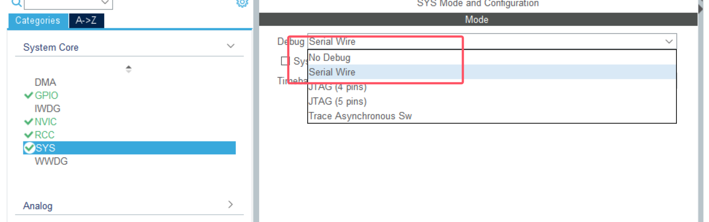

*图 2　SYS 中 Debug 选择 Serial Wire*

在时钟树里把 SYSCLK 拉到 72 MHz，同时把 APB1 设成二分频（36 MHz）。

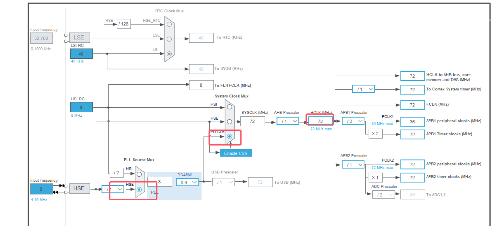

*图 3　时钟树：SYSCLK = HCLK = 72 MHz，APB1 = 36 MHz*

工程名和工具链决定了生成出来的 Keil 工程叫什么、放在哪个目录。

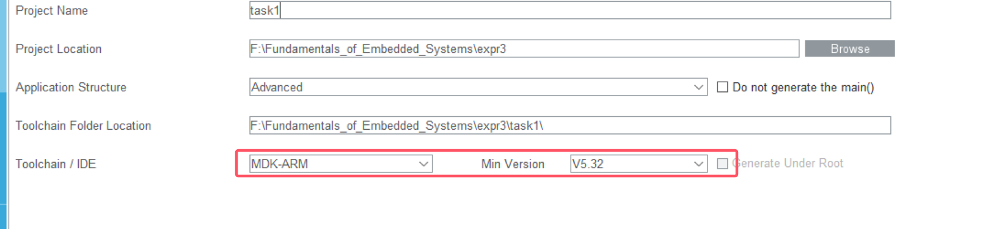

*图 4　Project Manager 中的工程名与 MDK-ARM 工具链*

勾选这两项之后，每个外设的初始化代码会单独生成到 tim.c、gpio.c 及对应头文件里。

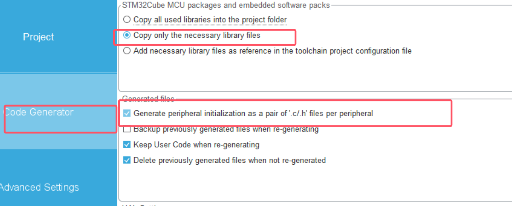

*图 5　Code Generator 中"只复制必要库文件"与"按外设生成 .c/.h"*

PSC 与 ARR 相乘正好是 1 s，这两个数就是任务一的时间基准。

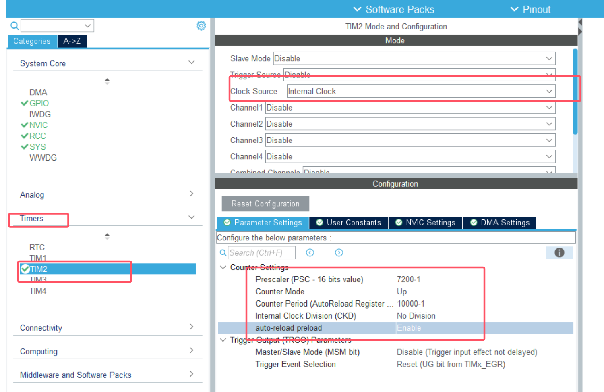

*图 6　TIM2 选内部时钟，PSC = 7200-1、ARR = 10000-1，定时 1 s*

勾上这一项，计数器每次溢出时 CPU 才会跳进中断去翻转引脚。

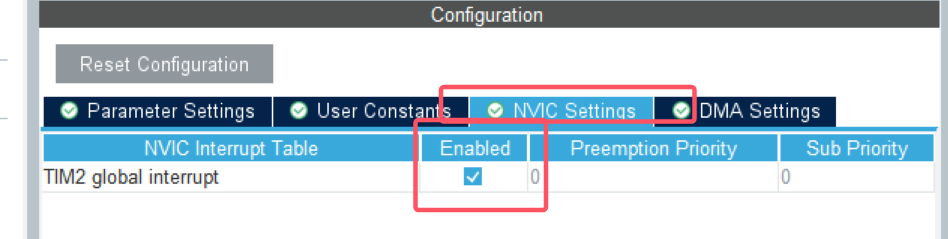

*图 7　NVIC 中使能 TIM2 global interrupt*

在引脚图上直接把 PA0 定为输出，CubeMX 会自动把 GPIOA 的时钟和寄存器配置一起生成好。

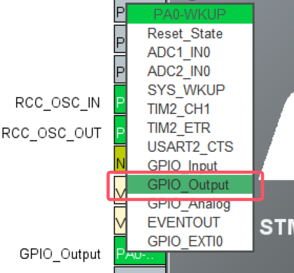

*图 8　把 PA0 配置为 GPIO_Output*

确认模式是推挽（不是开漏）、初始电平为低，否则灯要么不亮、要么一上电就亮着。

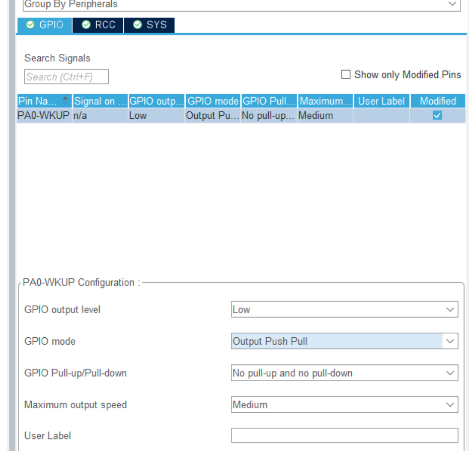

*图 9　PA0 输出参数：推挽输出、初始低电平*

### 4.2 代码实现

代码写在 `main.c` 的 `USER CODE` 区域内，重新生成代码时不会被覆盖。

```c
/* USER CODE BEGIN 2 */
HAL_TIM_Base_Start_IT(&htim2);   // 启动计数，同时使能更新中断 
/* USER CODE END 2 */
```

```c
/* USER CODE BEGIN 4 */
void HAL_TIM_PeriodElapsedCallback(TIM_HandleTypeDef *htim)   // 每 1 s 调用一次 
{
  if (htim->Instance == TIM2)
  {
    HAL_GPIO_TogglePin(GPIOA, GPIO_PIN_0);    
}
/* USER CODE END 4 */
```

三个易错点：函数名 `HAL_TIM_PeriodElapsedCallback` 必须一字不差（它是 HAL 预留的弱函数）；不要自己再写 `TIM2_IRQHandler`（`stm32f1xx_it.c` 已生成，会转调 HAL）；启动函数别漏掉 `_IT` 后缀。

主循环 `while (1)` 里什么都不用写。按 F7 编译（0 Error）后用 ST-Link 下载。

### 4.3 实验现象

PA0 上的红色 LED 以**亮 1 s、灭 1 s** 循环，周期 2 s。

下载后实测：红灯亮 1 s、灭 1 s，肉眼可见的 2 s 周期。

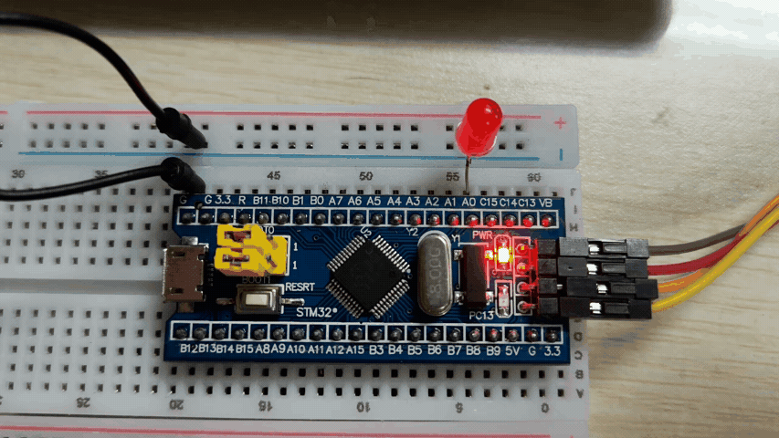

*图 10　任务一运行现象：PA0 上的红色 LED 亮 1 s、灭 1 s（周期 2 s）*

### 4.4 时序核对

| 项目 | 理论值 | 依据 |
| --- | --- | --- |
| 计数频率 | 10 kHz | 72 MHz ÷ 7200 |
| 更新中断周期 | 1.000 s | 7200 × 10000 ÷ 72 MHz |
| LED 亮 / 灭时间 | 各 1 s | 每次中断翻转一次 |
| **亮灭全周期** | **2 s** | 2 × 1 s |
| 占空比 | 50% | 亮灭时间相等 |

误差只取决于晶振精度（典型 ±20 ppm）和中断响应延迟（约 1 µs 级），回调里只有一次引脚翻转，因此定时几乎无可见偏差。

## 五、任务二：PWM 呼吸灯

### 5.1 复制出独立工程

把 `expr3\task1` 整目录复制为 `expr3\task2`，用 CubeMX 打开其中的 `.ioc`，**把 Project Name 改成 `task2`**，并确认 **Toolchain Folder Location 指向 `...\expr3\task2\`**。这一步不能省：路径若还指向 task1，一次生成就会把任务一的工程覆盖掉。

### 5.2 把 TIM2 通道 1 改成 PWM 输出

**模式**：TIM2 → Channel1 选 **PWM Generation CH1**（图 11、图 12）。此时 PA0 会自动变成 TIM2_CH1（复用功能），`System Core → GPIO` 里原来的 PA0 配置项消失，属正常现象。

**参数**（图 13，注意 PSC/ARR 与任务一完全不同）：

| 分组 | 参数 | 值 |
| --- | --- | --- |
| Counter Settings | Prescaler | **72-1**（72 MHz ÷ 72 = 1 MHz） |
| | Counter Period | **1000-1**（1 MHz ÷ 1000 = 1 kHz） |
| | auto-reload preload | Enable |
| PWM Generation Channel 1 | Mode | PWM mode 1 |
| | Pulse | 0 |
| | Output compare preload | Enable |
| | CH Polarity | High |

**中断**：NVIC 中**取消** TIM2 global interrupt（图 14），波形由硬件产生，主循环只改 CCR，不需要中断。

保存后生成代码，核对 `tim.c`：`Init.Prescaler = 72-1`、`Init.Period = 1000-1`、`OCMode = TIM_OCMODE_PWM1`、`Pulse = 0`、`OCPolarity = HIGH`，PA0 为 `GPIO_MODE_AF_PP`。

复用成 TIM2_CH1 后，PA0 不再是普通 IO，而是定时器的输出引脚。

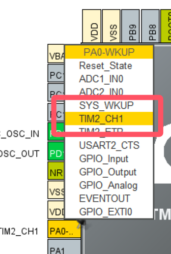

*图 11　把 PA0 复用为 TIM2_CH1*

通道 1 必须选 PWM Generation，硬件才会按比较结果自动翻转电平。

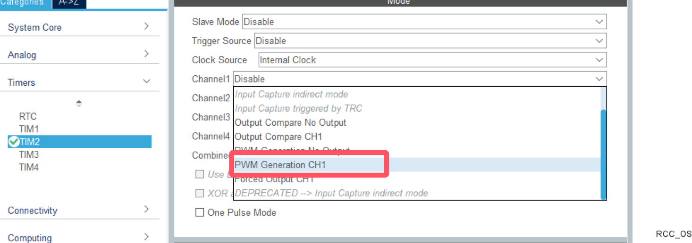

*图 12　Channel1 选择 PWM Generation CH1*

72 分频得到 1 MHz 计数，1000 个计数构成一个周期，于是 PWM 频率为 1 kHz。

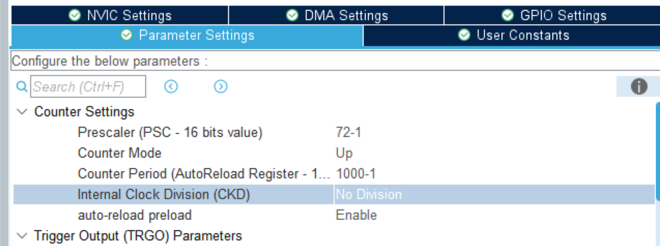

*图 13　PSC = 72-1、ARR = 1000-1，得到 1 kHz、1000 级调光*

呼吸灯靠主循环改 CCR、波形由硬件生成，因此更新中断可以整个关掉。

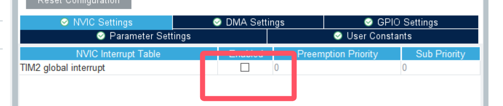

*图 14　PWM 模式不再需要更新中断*

### 5.3 代码实现

```c
/* USER CODE BEGIN 2 */
HAL_TIM_PWM_Start(&htim2, TIM_CHANNEL_1);   /* PA0 开始输出 PWM */
/* USER CODE END 2 */
```

```c
/* USER CODE BEGIN 3 */
while (1)
{
    for (uint32_t i = 0; i < 1000; i++)      
    {
        __HAL_TIM_SET_COMPARE(&htim2, TIM_CHANNEL_1, i);
        HAL_Delay(1);
    }
    for (uint32_t j = 1000; j > 0; j--)     
    {
        __HAL_TIM_SET_COMPARE(&htim2, TIM_CHANNEL_1, j);
        HAL_Delay(1);
    }
}
/* USER CODE END 3 */
```

`__HAL_TIM_SET_COMPARE` 就是改写 CCR1；因为 `Output compare preload` 已使能，新值在下一个 PWM 周期生效，不会出现半个周期的怪波形。可改进处：写 `i <= 1000` 才能真正到 100%，循环变量用 `uint16_t` 更贴合 CCR 位宽；若把 CCR 换成 `duty*duty/1000`（平方映射），按人眼对数特性会更像真实呼吸。

### 5.4 实验现象

LED 由暗渐亮、再渐暗，一个完整呼吸周期约 **2 s**。

实测呼吸效果：由暗渐亮、再由亮渐暗，一个来回约 2 s。

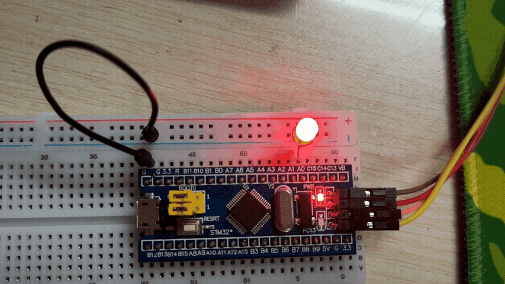

*图 15　任务二运行现象：占空比 0→100%→0，LED 渐亮渐灭*

### 5.5 Keil 软件仿真 + 逻辑分析仪观察

**配置**：`Options for Target → Debug` 选 **Use Simulator**，核对 **CPU DLL = SARMCM3.DLL / -REMAP**、**Dialog DLL = DARMSTM.DLL / -pSTM32F103C8**，勾选 `Run to main()`；F7 重新编译后 **Ctrl + F5** 进入调试。`-p` 参数必须写具体型号，用默认的 `-pCM3` 认不出 TIM2 的寄存器。

**添加信号**：`View → Analysis Windows → Logic Analyzer` → `Setup...`，加三个信号（图 16、图 17）：`TIM2_CNT`（Analog，0~999）、`TIM2_CCR1`（Analog，0~999）、`TIM2_SR`（Bit，And Mask = `0x00000001`）。

三个信号分别对应计数、比较值和标志位，是分析 PWM 所需的最小集合。

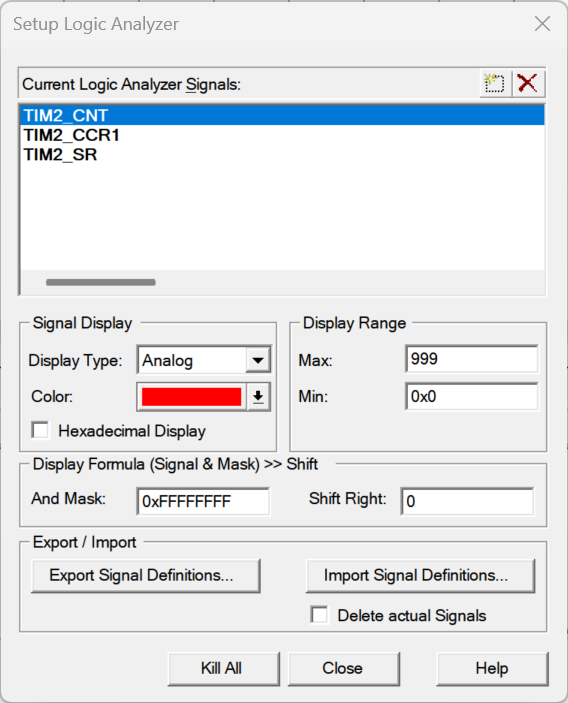

*图 16　逻辑分析仪中添加 TIM2_CNT、TIM2_CCR1、TIM2_SR 三个信号*

只保留 bit0，才能把 32 位的状态寄存器变成一根 0/1 数字线。

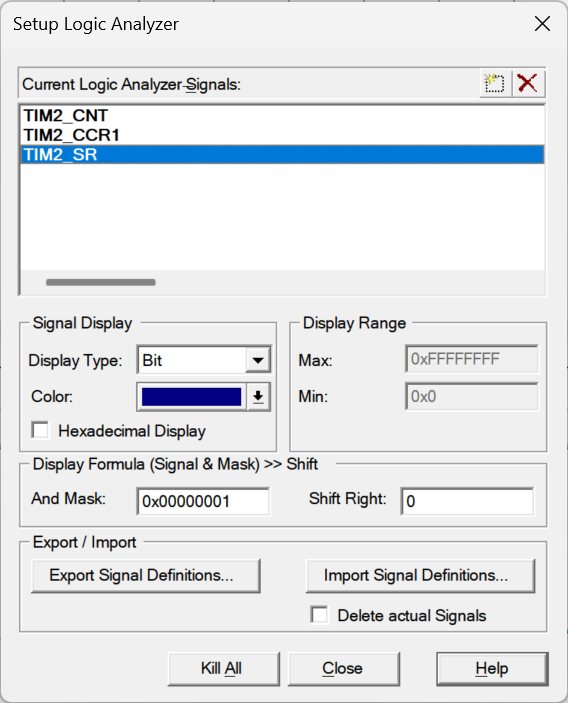

*图 17　TIM2_SR 设为 Bit 显示，掩码 0x00000001 只取 UIF 位*

**测量结果**：`TIM2_CCR1` 是一条缓慢上升再下降的三角波，峰谷为 999 和 0，说明占空比在 0~100% 之间周期扫描（图 18）。把游标分别停在同值两处（均 989），读得 Δ = **4.000716 s**；由于这条三角波一个升降循环为 2 s，该间隔正好跨**两个**周期，折算单周期

```
4.000716 s ÷ 2 = 2.000358 s ≈ 2.000 s
```

与设计值 2 s 吻合（偏差约 0.02%），说明"每 1 ms 改一档、共 1000 档"的时间换算正确。

三角波上两个同值点之间跨了两个呼吸周期，由此折算单周期约 2.0004 s。

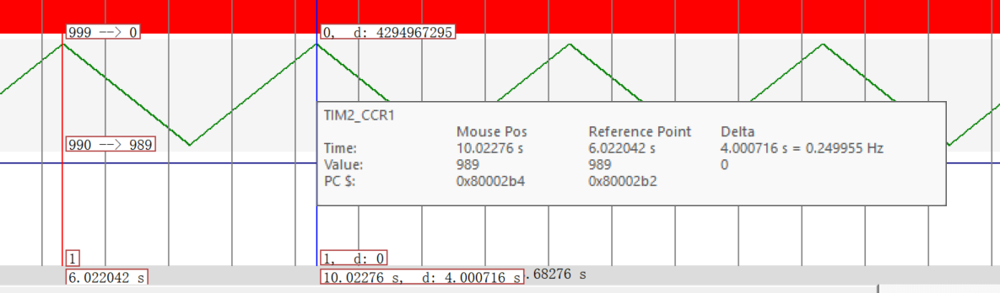

*图 18　TIM2_CCR1 的三角波与游标测量（Δ = 4.000716 s，跨 2 个呼吸周期）*

**亮度换算举例**：

| CCR1 | 占空比 | 高电平时间 | 平均电压 |
| --- | --- | --- | --- |
| 100 | 10% | 100 µs | 0.33 V |
| 300 | 30% | 300 µs | 0.99 V |
| 500 | 50% | 500 µs | 1.65 V |
| 900 | 90% | 900 µs | 2.97 V |

**仿真的局限**（一并记录）：Keil 的 STM32 仿真模型只模拟寄存器行为、**不驱动引脚电平**，`porta.0` 恒为 0，且 F1 的定时器输出不回写 `GPIOA_ODR`，因此引脚方波无法在仿真中看到；`TIM2_SR` 的 UIF 在 PWM 模式下无人清除，置位后一直为 1；`TIM2_CNT` 只在重装时刻刷新。引脚级波形需示波器或逻辑分析仪实测，本实验不具备该条件，报告中的方波均为按参数推算。

### 5.6 与理论波形的对照

按本实验参数（1 MHz 计数、1 kHz PWM）绘制的理论示意如图 19、图 20。对照 5.5 节：`TIM2_CCR1` 三角波上**每一点的纵坐标**就是图 19 中某个方波的占空比——读到 CCR1 = 300，此刻 PA0 上就是占空比 30%、高电平 300 µs 的方波（图 20 下半部分），平均电压 0.99 V；读到 900 则占空比 90%、平均电压 2.97 V，灯很亮。CCR1 沿三角波往复变化，亮度随之呼吸。

四个占空比排在一起，高电平越来越宽，对应 LED 越来越亮。

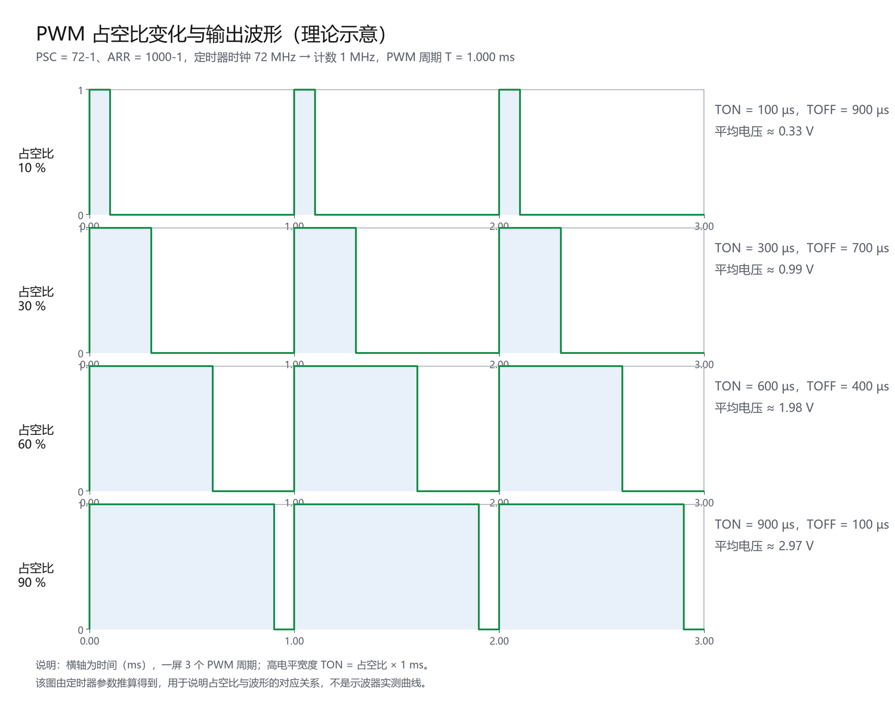

*图 19　占空比 10% / 30% / 60% / 90% 对应的 PWM 波形（按参数推算的理论示意）*

上下两栏对齐着看：CNT 越过 CCR1 的那一刻，输出正好翻成低电平。

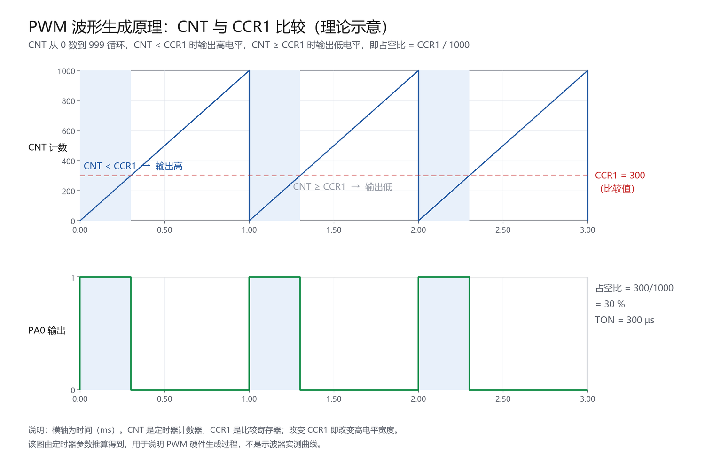

*图 20　CNT 与 CCR1 的比较过程：CNT < CCR1 输出高、否则输出低（按参数推算的理论示意）*

## 六、问题与解决

**1. LED 完全不亮——GPIO 设成了开漏**
PA0 的 `GPIO mode` 一开始选成 **Output Open Drain**（图 21），开漏输出高电平时引脚悬空、给不出 3.3 V，而 PA0 上没有上拉电阻，所以灯不亮。改成 **Output Push Pull** 后正常。

这就是当时导致灯不亮的设置：GPIO mode = Output Open Drain。

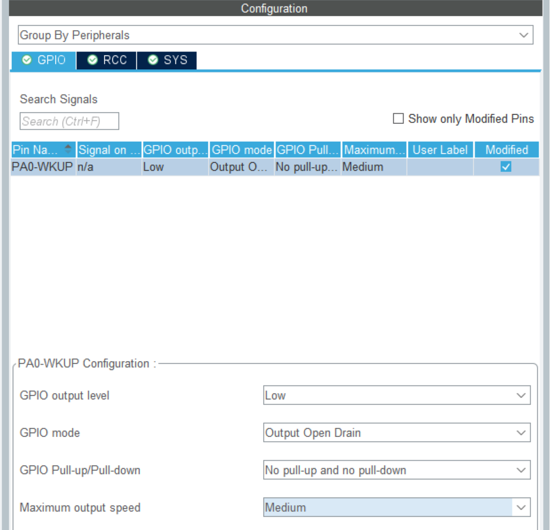

*图 21　踩坑：GPIO mode 误设为 Output Open Drain，导致 LED 不亮*

**2. 复制工程后工程名没改，差点覆盖任务一**
复制出的 `task2` 目录里 `.ioc` 内部仍是 `ProjectName = task1`，此时生成代码会把 Keil 工程写回 `task1` 目录。解决：生成前先改 Project Name 并核对 Toolchain Folder Location。

**3. 逻辑分析仪认不出 `TIM2_CNT`**
`Dialog DLL` 默认是 `DCM.DLL / -pCM3`（通用 Cortex-M3 模型），改成 `DARMSTM.DLL / -pSTM32F103C8` 加载 STM32 外设模型后即可识别。

**4. 仿真里看不到 PA0 方波、`TIM2_SR` 恒为 1**
前者是仿真模型不驱动引脚，后者是 UIF 置位后无人清除，都不是程序错误。改用 `TIM2_CCR1`、`TIM2_CNT` 间接观察，并在报告中如实标注推算值。

下图就是当时尝试用 `TIM2_SR` 量周期的结果：看似读出了 2.000569 ms，但因为 SR 在 PWM 模式下恒为 1，这个数字只是两条游标之间的距离，与 PWM 周期无关——这正是“仿真里该看什么、不该看什么”的一个反例。

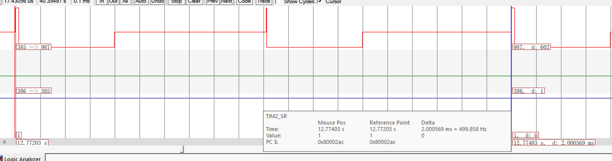

*图 22　`TIM2_SR` 恒为 1 时的游标读数（Δ = 2.000569 ms），仅表示两条游标的间距，不能当作 PWM 周期*


## 七、实验结论

1. 时基由 PSC 与 ARR 决定，`T = (PSC+1)(ARR+1)/f_TIM`。任务一取 7200-1 与 10000-1，在 72 MHz 定时器时钟下得到 1 s 更新周期，中断翻转 PA0 实现 **2 s 周期亮灭**。
2. 同一 TIM2 改为 PWM 输出，`PSC = 72-1`、`ARR = 1000-1` 得 **1 kHz**、1000 级调光，无频闪。
3. 每 1 ms 改一次 `CCR1` 使占空比在 0~100% 扫描，全周期 **2 s**；仿真测得 CCR1 三角波周期折算 **2.0004 s**，与设计偏差约 0.02%。
4. PWM 波形由硬件产生、CPU 只改 CCR，这是它与"中断翻转 IO"的本质区别；仿真可观察寄存器行为，但**不模拟引脚电平**，引脚波形须实测。

## 八、实验体会

这次实验最让我意外的是，**同一个 TIM2 就能同时管住两个完全不同的时间尺度**：任务一要 1 s 的等待，任务二要 1 ms 的波形，差别只在 PSC/ARR 的数量级，以及"CPU 参不参与"——任务一靠中断翻引脚，任务二只改一个数、波形全交给硬件。想明白这一点，`__HAL_TIM_SET_COMPARE` 就从一个"赋值"变成了"向硬件报占空比"。

另一件印象深的是"先算后填"。PSC/ARR 填的是减一后的值，APB1 上的定时器时钟还要乘 2，两个反直觉叠在一起很容易算错；我先用公式算出 1 s 和 1 ms、填完再反验一遍才敢生成。坑也踩了两个：GPIO 选成开漏导致灯不亮（开漏只有下拉能力），以及本以为能在仿真里直接看 PA0 方波，结果发现仿真只走寄存器、不走引脚。这两件事让我形成一个习惯——**先怀疑配置、再怀疑代码**，并且清楚工具能告诉你什么、不能告诉你什么。
